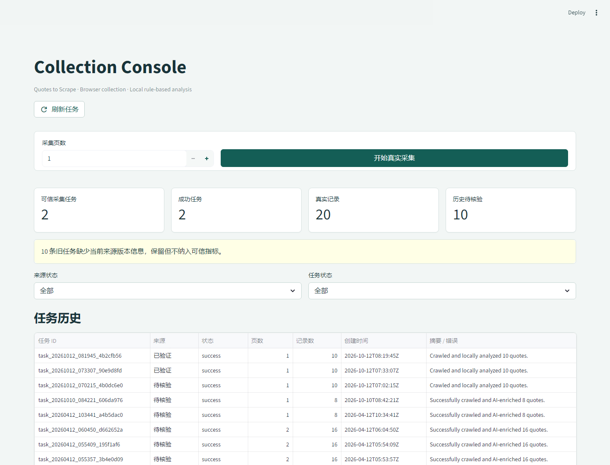
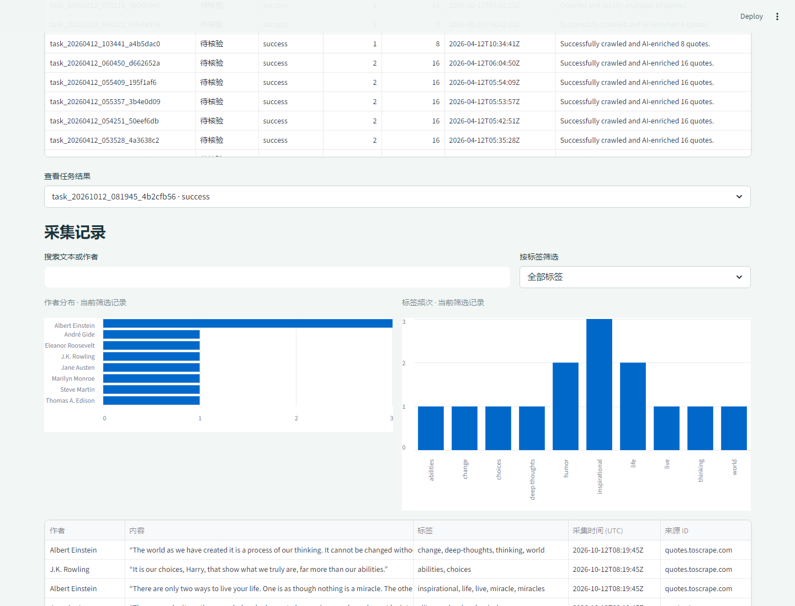

# AI Browser Agent

一个可复现的公开网页采集与分析作品集项目。通过 Playwright 抓取 [Quotes to Scrape](https://quotes.toscrape.com/)，保存带有来源和时间戳的记录，使用本地规则进行轻量文本分析，并通过 Streamlit 控制台检索和查看结果。





## 功能

- 配置采集页数，通过 FastAPI 后台创建 Playwright 采集任务。
- 为每条记录保存稳定记录 ID、来源 ID、实际页面 URL、UTC 采集时间、页码、作者、文本和标签。
- 按规范化后的文本与作者进行跨页去重，并在任务报告中记录重复数量。
- 使用本地关键词规则生成主题、情绪、语气和摘要，不调用外部 LLM。
- 按任务 ID 将任务状态、采集结果和分析报告保存为 JSON 文件。
- 在仪表盘中筛选任务来源与状态、搜索文本或作者、按标签筛选，并查看来源链接及基于当前筛选结果生成的统计图。
- 支持查看缺少当前来源版本信息的历史任务，但会将其标记为待核验，并排除在可信指标之外。

## 技术栈与数据流

```text
Streamlit UI
    |
    | Create task
    v
FastAPI -> Background Task
                 |
                 v
       Playwright Crawler
                 |
                 v
       Quotes to Scrape
                 |
                 v
       Data Deduplication
                 |
                 v
       Local Rule Analyzer
                 |
                 v
       Task Manager -> JSON Files

Streamlit UI <-> FastAPI
                   |
                   +-- Task List API
                   +-- Task Detail API
                   +-- Metrics Summary API
```

主要组件：Python 3.11+、FastAPI、Pydantic、Playwright、Streamlit、Pandas 和本地 JSON 文件存储。

当前项目不需要数据库、LLM API 密钥、Docker 或登录凭证。

## 数据存储与来源追溯

每个任务存储在 `data/tasks/<task_id>/` 目录下：

- `task.json`：任务状态、时间、来源版本和聚合计数。
- `quotes_all.json`：去重后的采集记录及逐条来源元数据。
- `report.json`：统计结果、重复数量、分析方法和来源版本。
- `meta.json`：任务创建参数。

只有包含 `provenance_version: 1` 的任务才纳入可信统计。缺少当前来源版本信息的旧任务仍可查看，但不会被自动迁移或覆盖。

## 环境配置

环境要求：Python 3.11+、Windows PowerShell。

在项目根目录执行：

```powershell
py -3.11 -m venv venv
venv\Scripts\Activate.ps1
python -m pip install --upgrade pip
pip install -r requirements.txt
python -m playwright install chromium
```

Playwright 浏览器需要单独安装。首次采集时，本机需要能够访问 `quotes.toscrape.com`。如果目标页面无法访问或页面结构不匹配，任务会标记为失败并保留错误信息，不会生成伪造结果。

## 启动

在项目根目录打开两个 PowerShell 窗口，分别启动 API 和 UI。

**终端一：启动 FastAPI**

```powershell
venv\Scripts\Activate.ps1
uvicorn app.api.server:app --reload
```

**终端二：启动 Streamlit**

```powershell
venv\Scripts\Activate.ps1
streamlit run ui/dashboard.py
```

打开 Streamlit 输出的本机地址，默认是 `http://localhost:8501`。

其他地址：

- API 文档：`http://127.0.0.1:8000/docs`
- 健康检查：`http://127.0.0.1:8000/health`

## API

| 方法 | 路径 | 说明 |
|---|---|---|
| `GET` | `/health` | 查询服务健康状态 |
| `POST` | `/tasks/run` | 创建采集任务 |
| `GET` | `/tasks` | 按创建时间倒序列出任务 |
| `GET` | `/tasks/metrics/summary` | 获取可信来源版本的任务统计，并单独列出未验证任务数量 |
| `GET` | `/tasks/{task_id}` | 获取任务信息、分析报告及最多 10 条结果预览 |
| `GET` | `/tasks/{task_id}?include_quotes=true` | 获取任务信息及完整采集结果 |

创建任务的请求示例：

```json
{
  "pages": 1,
  "mode": "local"
}
```

其中，`pages` 用于指定采集页数，`mode` 当前使用 `local` 模式。

任务创建后，后端会返回任务状态。可以通过任务详情接口查询 `pending`、`running`、`success` 或 `failed` 等状态。仪表盘支持手动刷新。

## 测试与本地检查

运行单元测试：

```powershell
python -m unittest discover -s tests -v
```

检查关键 Python 文件的语法：

```powershell
python -m py_compile app/api/server.py app/crawler/quotes_spider.py app/task/task_manager.py ui/dashboard.py
```

单元测试使用替身数据验证数据转换、来源校验、去重和任务状态，不访问外网。

手动端到端验证可在启动 API 和 Streamlit 后，从仪表盘创建一个采集页数为 1 的任务，并检查任务详情中的 `source_url`、`captured_at`、`record_id` 和 `analysis_method` 等字段。

## 项目结构

```text
app/
  analyzer/       本地规则分析与任务统计
  api/
    server.py     FastAPI 路由与后台任务管线
  crawler/
    quotes_spider.py
                  Playwright 网页采集器
  task/
                  JSON 任务生命周期与持久化
ui/
  dashboard.py    Streamlit 采集控制台
  api_client.py   本机 FastAPI 客户端
data/
  tasks/          按任务隔离的 JSON 结果
assets/           项目截图
tests/            离线单元测试
```

## 作品集说明

本项目目前使用公开测试网站 `quotes.toscrape.com` 验证浏览器自动采集流程，尚未用于真实客户项目，也不代表已产生商业收入。

项目展示了网页信息自动采集、任务状态管理、数据去重与来源追溯、可信指标统计和可视化查看等能力，可作为网页信息采集、数据整理与监控类自动化需求的技术验证基础，并可根据实际数据源、业务规则和交付要求进一步定制。
